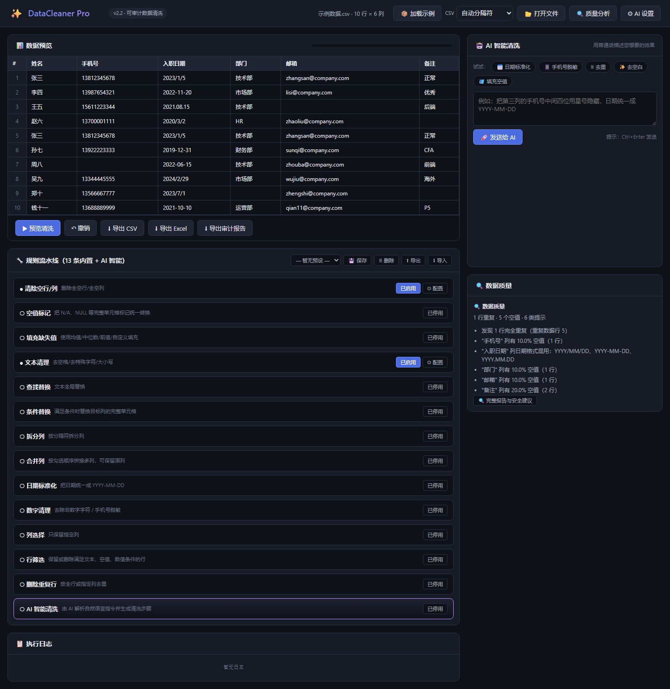

<div align="center">

# DataCleaner Pro · AI

**纯前端、零依赖的表格数据清洗工具 —— 打开一个 HTML 文件就能用，数据永不离开你的浏览器。**

[](LICENSE)
[](#为什么是零依赖)
[](#测试)
[](#交付清单)
[](#快速开始)

</div>

---

## 演示视频

**[观看 1 分 46 秒中文演示](DataCleaner-demo.mp4)**：从导入表格、自然语言清洗到差异确认与导出，完整展示本地数据处理流程。

## 这是什么

导入 CSV 或 Excel，用**规则流水线**或**自然语言**清洗数据，再导出回 CSV / Excel。

```
Excel / CSV → 质量诊断 → 清洗步骤 → 差异预览 → 应用确认 → Excel / CSV / 审计报告
```

**版本状态：已完成。** 当前版本的功能实现、自动化回归和使用文档均已完成，283 个测试用例全部通过。

和同类工具的区别在于三点：

- **数据不上传。** 全部计算在浏览器本地完成，没有后端。处理身份证、手机号、工资表这类数据时，这不是"更放心"，而是合规前提。
- **零第三方依赖。** 不引 SheetJS、不引 Papa Parse、没有 `npm install`、没有构建步骤。整个项目 ~200 KB，双击 `index.html` 即可运行，断网也能用。
- **AI 是可选项。** 不填 API Key，内置启发式引擎照样能识别常见指令。AI 只是让"说人话"变成可能，不是运行的前提。

## 截图



## 功能

### 数据读写

| 能力 | 说明 |
|---|---|
| CSV 无损解析 | 字符流状态机：支持字段内换行、`""` 转义、CRLF；按多行一致性嗅探分隔符，也可手动覆盖；单列文本不会被逗号拆散 |
| 异常行保护 | 长行额外字段全部保留并自动补列名，短行补空值；明确报告异常行，绝不静默截断 |
| 编码自适应 | UTF-8 / GBK 自动识别 + BOM 处理，直接吃中文 Excel 导出的 CSV |
| Excel 导入 | `.xlsx` 零依赖解析：共享字符串、`inlineStr`、日期序列号、多工作表选择 |
| Excel 导出 | `.xlsx` 零依赖生成，表头加粗；前导零与长数字串不失真 |
| 拖拽导入 | 拖文件到表格区即可加载 |

### 清洗

| 能力 | 说明 |
|---|---|
| 规则流水线 | 13 条内置规则：空行/空列、空值标记、填充空值、文本清理、查找替换、条件替换、拆分列、合并列、日期标准化、数字规整、列选择、行筛选、去重；AI 可重命名/删除列及执行安全公式 |
| 自然语言清洗 | 描述需求 → AI 生成步骤 → **你确认后**才注入流水线 |
| 差异预览 | 每次从不可变原始输入重算；显示修改数、增删行和影响列，全部值修改均可分页核对，确认后才应用 |
| 严格日期 | 校验真实年月日；`2024/2/30` 等非法日期保留原值并写入异常报告，不再悄悄变成其他日期 |
| 安全公式 | `col:N`、数字、四则运算、括号由 AST 解析器求值；不使用 `eval` / `Function`，拒绝属性访问和函数调用 |
| 撤销 | 预览阶段取消预览；应用后可撤销上一次已提交结果 |
| 合并/拆分列 | 按指定分隔符和列顺序合并或拆分；合并可保留原列、跳过空值，输出列重名时自动加序号 |
| 条件/空值/筛选 | 按文本、空值或严格数值条件筛选行、整格替换目标列；空值标记只匹配完整单元格。未完整配置时跳过，不猜测列、不误删全表 |

### 使用体验

| 能力 | 说明 |
|---|---|
| 规则预设 v2 | 保存规则、AI 步骤和源列结构；兼容 v1 JSON；列名不匹配时要求显式映射，不按旧列号猜测 |
| 审计报告 | 离线导出 HTML，包含清洗步骤、质量画像、异常数据行号和操作日志；不包含完整数据内容 |
| 分页 | 每页 100 行，首/上/下/末页 + 跳页，显示全局行号 |
| 后台执行 | CSV/XLSX 读取解析、规则流水线、质量画像、CSV/XLSX 导出和差异分页优先使用本地 Blob Worker；大表分块返回，支持取消及旧任务隔离，WebKit 文件读取和无 Worker 环境有兼容路径 |
| 多模型 | DeepSeek / 通义千问 / OpenAI / 自定义 OpenAI 兼容端点 / 浏览器本地 WebLLM |
| 流式输出 | AI 分析过程逐字渲染，不用干等 |
| 多轮对话 | 「不对，改成 DD/MM/YYYY」—— 在上一轮基础上调整，不重置 |


### 大文件与后台执行

CSV 和 XLSX 的文件读取、解码、解压与解析优先在 Worker 中执行，并自动适配不同浏览器的文件读取能力。XLSX 使用自包含的只读 XML 解析器，不依赖主线程 `DOMParser`。规则流水线、质量画像、CSV/XLSX 导出也在 Worker 中执行，导出结果以 Blob 返回。

大表按 1 万行、修改/删除标记按 5 万条分块异步返回；多工作表 XLSX 同样按工作表和行分块。Worker 用两份 LRU 缓存保留原始输入和最近结果，重复预览、紧随其后的画像、导出及差异分页可直接复用缓存。差异弹窗每次只在后台取 100 条并渲染当前页，可直接跳到最后一处修改。初始表和撤销快照采用不可变引用共享，规则配置仍独立复制；关闭多工作表选择弹窗会释放未选工作表。

2026-11-12 在本机 Windows + Chromium 的一次 25 万行 × 6 列、12.4 MiB 真实临时 CSV 检查中：导入 + 首次画像约 1.92 秒，预览出现约 2.41 秒；导入、预览（含随后画像）、差异分页/应用/撤销阶段的最大心跳间隔分别约 43、131、152 ms。测试同时验证了 50 万个修改标记、直接跳到最后一处差异、应用、撤销、取消和连续导入。

同一轮验证还使用 openpyxl 生成并读回 2 万行 × 4 列真实 XLSX，确认导入与导出均走 Worker、最后一页数据完整，导入和导出阶段最大心跳间隔分别约 30、27 ms。基准脚本和临时数据生成均包含在仓库中，可直接复测。

可用以下命令复测（默认 12 万行；临时文件在结束后删除）：

```powershell
$env:DC_BENCH_ROWS = "250000"
python tools/test_worker_browser.py
```

## 浏览器兼容性

Excel 读写使用浏览器原生的 `DecompressionStream` / `CompressionStream`，这也是零依赖实现的一部分：

| 浏览器 / 引擎 | CSV 清洗 | Excel 读写 |
|---|---|---|
| Chrome / Edge 103+ | ✅ Chromium 自动化回归通过 | ✅ Chromium 自动化回归通过 |
| Firefox 113+ | ✅ Firefox 自动化回归通过 | ✅ Firefox 自动化回归通过 |
| WebKit（Playwright） | ✅ WebKit 自动化回归通过 | ✅ WebKit 自动化回归通过 |

**CSV 不依赖这些压缩流 API**；Worker 不可用时自动使用主线程兼容路径。Excel 导入导出具备明确的浏览器能力检测和错误提示。

## 隐私与安全

**数据本身**：不上传，不落盘，没有遥测。关掉标签页就什么都不剩。你可以断网后打开 `index.html` 验证这一点。

**唯一的例外**：当你主动配置了云端 Provider（DeepSeek / 通义 / OpenAI）并点击发送时，会把**列名和前 10 行数据**作为 Prompt 上下文发给该服务商。这是让 AI 理解你数据结构的必要代价。如果这些数据敏感：

- 用默认的「启发式（无 API）」Provider —— 完全不联网；
- 或用 `webllm` 在浏览器内本地推理（首次需联网下载模型权重）。

**关于 API Key**：填入的 Key 保存在浏览器 `localStorage`（键名 `dc_ai_config`），**明文存储**。这是纯前端应用无法回避的取舍 —— 没有后端就没有安全的密钥托管处。因此：

- 不要在公用电脑上填写 Key；
- 建议使用有额度上限的测试 Key；
- 同源的任何脚本都能读到它，请勿在本项目中引入不可信的第三方脚本。

如果你的场景不允许这种存储方式，请使用启发式或本地模型 Provider。

## 快速开始

**方式一：直接打开**

克隆或下载后双击 `index.html`。没有构建、没有安装、断网可用。

**方式二：本地 HTTP 服务**（推荐，某些浏览器对 `file://` 的限制更严）

```bash
python -m http.server 8080
# 打开 http://localhost:8080
```

**先点「📦 加载示例」** 就能看到完整流程，不需要任何配置。

基本工作流：打开文件（CSV 可先选手动分隔符）→ 配置规则 →「预览清洗」→「查看前后差异」→「应用清洗」→ 导出。未提交的预览不能被当作清洗结果导出；「导出审计报告」可在预览或应用后使用。

### 不用 API Key 也能体验

默认 Provider 是「启发式（无 API）」，能识别这类指令：

- 把日期统一成 YYYY-MM-DD
- 把手机号中间四位隐藏
- 删除完全重复的行
- 把部门列空值填为未知
- 清理姓名列的空白

### 接入大模型

1. 点右上角「⚙ AI 设置」
2. 选择 Provider，填入 API Key（**请先读上面的隐私与安全**）
3. 输入自然语言指令 → 观察流式分析 → 点「✅ 一键应用」

单次调用约 1100 tokens（数据 500 + Prompt 300 + 回复 300）。主流国产模型的实际花费通常在每次一分钱以内，但**具体价格请以服务商当前页面为准**。


## 项目结构

```
.
├── index.html            # 单页界面（无模板引擎、无框架）
├── css/style.css         # 暗色主题
├── js/
│   ├── rules.js          # 规则引擎：13 条内置规则 + 流水线执行 + 改动追踪
│   ├── io.js             # IO 层：CSV 状态机、XLSX 读写（手写 ZIP + XML）、预设序列化
│   ├── worker.js         # Blob Worker：后台任务、分块传输、短期缓存、取消与兼容回退
│   ├── ai.js             # AI 层：Provider 抽象、Prompt 构造、流式解析、启发式兜底
│   └── app.js            # UI 与状态：渲染、分页、对话、回滚、导入导出
└── tools/                # 测试（Python 驱动，见下）
```

五个 JS 文件通过 `DCRules` / `DCIO` / `DCAI` / `DCWorker` 协作，没有模块打包器。Worker 直接序列化现有规则和 IO 工厂函数，不请求本地脚本、不维护第二份规则实现，也不需要构建步骤。这是刻意的：它让"双击 HTML 就能跑"成为可能。

## 为什么是零依赖

引入 SheetJS 读写 Excel 会带来约 1 MB 的体积，且通常需要 CDN 或构建步骤 —— 这会破坏"离线可用、双击即开"这个核心特性。

于是 Excel 支持是手写的：

- **读**：手写 ZIP 中央目录解析（含 ZIP64 分支）→ 原生 `DecompressionStream('deflate-raw')` 解压 → Worker 安全的轻量 XML 树解析（命名空间、实体、CDATA，不加载 DTD/外部实体）→ 处理共享字符串、`inlineStr`、日期序列号（含 1900 闰年 Bug 补偿）
- **写**：手写 CRC32 查表 + 本地文件头 / 中央目录 / EOCD 组装 → 原生 `CompressionStream('deflate-raw')` 压缩 → 生成最小合法工作簿

代价是 `io.js` 增加了约 14 KB，换来体积减少 98% 和完整的离线能力。

写入时特意处理了三个真实场景的坑：前导零编号（`007`）、超长数字串（手机号、身份证）会被 Excel 静默破坏，因此它们被强制写为文本；XML 非法控制字符会被剔除，避免生成打不开的文件。

## 测试

**不需要 Node.js。** 全部测试由 Python 驱动，共 283 个用例：

```bash
# 1) Python 规则辅助测试（部分逻辑是 Python 复刻，不能替代浏览器测试）
python tools/test_rules.py              # 35 用例

# 安装真实浏览器测试环境
pip install playwright && playwright install chromium

# 2) 真正的 js/rules.js + js/ai.js
python tools/test_engine_browser.py     # 41 用例

# 3) CSV / XLSX / 预设 / 分页
python tools/test_io_browser.py         # 61 用例

# 4) 完整 UI：AI、导入导出、撤销、质量分析
python tools/test_e2e_browser.py        # 23 用例

# 5) 本次数据安全与可审查性回归，全程 file://
python tools/test_regression_browser.py # 36 用例

# 6) 真实 openpyxl 工作簿（额外开发依赖）
pip install openpyxl
python tools/test_real_xlsx_browser.py  # 8 用例（含真实 2 万行 Worker 读写）

# 7) 合并/拆分、空值、条件替换与行筛选
python tools/test_transforms_browser.py # 25 用例（19 引擎 + 4 UI + 2 错误检查）

# 8) Worker、大数据、缓存、取消与兼容回退
python tools/test_worker_browser.py     # 27 用例，默认使用真实临时 12 万行 CSV

# 9) Chromium / Firefox / Playwright WebKit
playwright install chromium firefox webkit
python tools/test_cross_browser.py      # 27 用例（每个引擎 9 项）

# 10) 文件与语法冒烟检查
python tools/test_smoke_size.py
```

浏览器测试监听 `pageerror`，新增套件还监听控制台错误。核心修复必须执行真实 JavaScript，不能只靠 Python 复刻逻辑作结论。

覆盖范围包括：严格日期与四位年份、单列文本与手动分隔符、异常列数且不丢字段、原始输入不可变、重复拆分幂等、公式注入拒绝、AI 类型白名单和参数校验、预设恢复与列映射、差异预览/应用/撤销、数值列均值建议、审计报告，以及 XLSX 读写往返闭环。

新增变换套件专门覆盖：合并列的重名保护与勾选顺序、空值标记的完整单元格匹配、条件替换只修改目标列、文本/空值/数值筛选、非法数值条件不删全表、四规则串联，以及新规则的界面配置、预设换列名、撤销和审计导出。

XLSX 导出由 Python 标准库 `zipfile.testzip()` **独立校验**；真实工作簿测试还覆盖 openpyxl 自定义日期格式、绝对 workbook relationship 路径、2 万行 Worker 导入/导出与末页访问。Worker 套件覆盖 Excel/XML 后台任务、缓存导出、全部差异分页和无 Worker 回退；WebLLM 协议通过无网络伪引擎覆盖多轮消息、流式输出、初始化与生成取消、失败重试。

## AI 步骤协议

AI 被要求返回严格 JSON，前端解析后转成规则流水线：

```json
{
  "analysis": "检测到手机号列未脱敏，日期格式不统一",
  "steps": [
    { "type": "mask_column",    "column": "手机号", "pattern": "middle4" },
    { "type": "normalize_date", "column": "入职日期", "target_format": "YYYY-MM-DD" }
  ]
}
```

支持 9 种步骤类型：`mask_column`、`normalize_date`、`fill_empty`、`trim_whitespace`、`remove_duplicates`、`split_column`、`rename_column`、`delete_column`、`custom_formula`。

解析层能从代码块、裸 JSON 或混合文本中提取结果，并在**解析时**执行类型白名单、列名、枚举和公式参数校验。无效步骤会被忽略并在面板中列出原因，而不是延迟到执行阶段才失败。`custom_formula` 仅支持 `col:N`、数字、`+ - * /`、括号和一元正负号，最长 1000 字符；不支持任何函数、属性或全局对象访问。

## Provider 说明

| Provider | 需要 Key | 联网 | 说明 |
|---|---|---|---|
| `heuristic` / `mock` | ❌ | ❌ | 本地关键词启发式；也是测试用的确定性 Provider |
| `deepseek` / `qwen` / `openai` / `custom` | ✅ | ✅ | OpenAI 兼容接口，流式输出；`custom` 可自填 Base URL 与模型名 |
| `webllm` | ❌ | 首次需要 | 浏览器内本地推理，需 WebGPU；首次会下载模型权重 |

## 使用范围

当前版本面向 CSV 和 `.xlsx` 数据清洗，Excel 按单元格值读取并生成新工作簿。数据处理在浏览器内存中完成。AI 生成步骤须经过差异预览和人工确认。自动化回归覆盖 Chromium、Firefox 和 Playwright WebKit。

## 交付清单

- [x] CSV / XLSX 导入导出、编码识别、分隔符嗅探和多工作表导入
- [x] 13 条内置规则、9 类 AI 步骤、规则预设、质量诊断和审计报告
- [x] 差异分页、预览、应用确认、撤销和结果导出
- [x] Worker 后台处理、分块传输、缓存复用、任务取消和兼容回退
- [x] 多模型 Provider、多轮对话、流式输出、停止与失败重试
- [x] 使用文档、贡献指南、基准脚本和完整自动化回归

**以上功能均已完成，核心路径已纳入自动化回归；当前版本为完整交付状态。**

## 贡献

欢迎 issue 和 PR，详见 [CONTRIBUTING.md](CONTRIBUTING.md)。

一句话版本：**保持零依赖**，跑通 283 个测试用例，新功能配套真实浏览器测试。

## License

[MIT](LICENSE) © DataCleaner Pro AI Contributors
